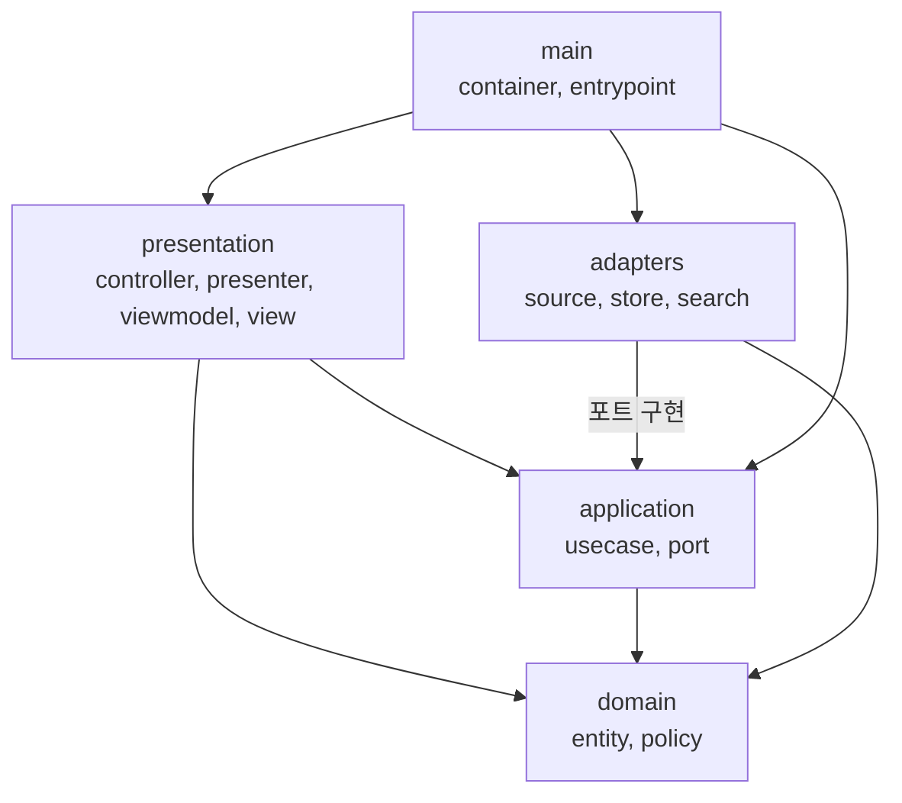

# 아카이브 사이트 소프트웨어 구조

| 항목 | 내용 |
|---|---|
| 문서 상태 | 초안 v0 |
| 작성일 | 2026-10-15 |
| 대상 | 아카이브 사이트의 코드 구조. 질문 생성 파이프라인은 [../ARCHITECTURE.md](../ARCHITECTURE.md) 참조 |
| 관련 문서 | [SPEC.md](./SPEC.md), [DESIGN.md](./DESIGN.md), [ADR-0001](../adr/0001-rendering-strategy.md), [ADR-0002](../adr/0002-auto-close-marker.md) |

## 1. 목적

사이트 코드를 레이어로 나누고 레이어 간 의존 방향을 고정합니다. 외부 시스템(GitHub, 파일, 검색 라이브러리)과 렌더링 방식은 교체 가능한 부품으로 분리합니다. 렌더링 방식이 아직 정해지지 않았으므로(ADR-0001) 이 분리가 구조 설계의 핵심 근거입니다.

## 2. 설계 원칙

| 원칙 | 내용 |
|---|---|
| 의존성 역전(DIP) | 상위 정책(유스케이스)이 인터페이스(포트)를 소유하고, 하위 세부 사항(어댑터)이 이를 구현 |
| 레고식 조립 | 구현체 선택은 `main/container`에서만 수행. 부품 교체가 다른 레이어의 수정으로 번지지 않음 |
| 프레임워크는 세부 사항 | 웹 프레임워크와 빌드 도구는 최외곽에 배치 |
| 읽기 전용 단순성 | 쓰기 경로가 없으므로 ViewModel은 불변 데이터로 한정 |
| 대체 구현 필수 | 모든 포트에 테스트용 대체 구현(fixture, 메모리)을 둠 |
| 수직 슬라이스 | 레이어별로 먼저 만들지 않고 슬라이스(S0~S4)에 필요한 요소만 관통해서 구현 |

### 결정 상태

| 항목 | 상태 |
|---|---|
| 클린 아키텍처 계열 레이어, DIP, 레고식 조립 | 확정 (요구사항 제공자 요청) |
| MVC와 MVVM 개념 반영 | 확정 (요구사항 제공자 요청) |
| 레이어 이름과 분할 수준 | AI 제안(확인 필요) |
| 포트 4종 | AI 제안(확인 필요) |
| Controller → Presenter → ViewModel → View 매핑 | AI 제안(확인 필요) |
| 사이트 소스를 `site/` 폴더에 배치 | AI 제안(확인 필요) |

## 3. 패턴 대응

| 패턴 | 이 프로젝트의 대응 | 적용 범위 |
|---|---|---|
| 클린 아키텍처 | domain, application, adapters, presentation 레이어와 조립부 main. 의존은 안쪽으로만 향함 | 전체 골격 |
| MVC | Controller는 요청을 받아 유스케이스 호출. View는 화면 템플릿. Model은 domain과 application | presentation |
| MVVM | ViewModel은 화면 표시용 불변 데이터. 데이터 바인딩과 양방향 동기화는 사용하지 않음 | presentation |

세 패턴은 하나의 흐름으로 연결됩니다.

```
Controller → UseCase → Presenter → ViewModel → View
```

Presenter가 도메인 결과를 ViewModel로 변환하고, View는 ViewModel만 읽습니다.

MVVM의 바인딩은 입력과 상태 변경이 있는 화면에서 이점이 큽니다. 이 사이트는 읽기 전용이고 입력이 검색에 한정되므로 바인딩을 도입하지 않습니다. 검색 화면에 클라이언트 상호작용이 생기면 재검토합니다.

## 4. 레이어와 의존 방향



화살표는 "알고 있음(import)"을 나타냅니다. domain은 아무것도 가리키지 않습니다.

## 5. 레이어별 책임

| 레이어 | 책임 | 구성 요소 | 의존 허용 | 의존 금지 |
|---|---|---|---|---|
| domain | 업무 규칙과 데이터 의미 | entities, policies | 없음 | 외부 라이브러리, 입출력, 다른 레이어 |
| application | 사용 사례의 흐름, 외부 접점 정의 | usecases, ports | domain | adapters, presentation, 프레임워크, 입출력 |
| adapters | 포트 구현(외부 시스템 연결) | source, store, search | application(ports), domain | presentation, 다른 어댑터 |
| presentation | 요청 처리와 화면 구성 | controllers, presenters, viewmodels, views, styles | application(usecases), domain | adapters |
| main | 구현체 선택, 조립, 진입점 | container, entrypoints | 전체 | 업무 규칙 |

View는 ViewModel만 입력으로 받습니다. domain 객체를 View로 직접 전달하지 않습니다.

## 6. 도메인 모델

필드명은 S0에서 GraphQL 실제 응답으로 확인합니다.

| 요소 | 내용 |
|---|---|
| Question | number, title, category, createdAt, closed, url |
| Answer | id, questionNumber, author(null 허용), body, createdAt, parentId |
| Author | login |
| Category | 제목의 `[카테고리]` 접두어에서 추출한 값 |
| AutoClosePolicy | 마감 댓글 판정 ([ADR-0002](../adr/0002-auto-close-marker.md)) |
| CategoryExtractor | 제목에서 카테고리 추출 |

## 7. 포트

| 포트 | 소유 레이어 | 메서드(개념) | 실제 구현 | 대체 구현 |
|---|---|---|---|---|
| DiscussionSource | application | fetchAll, fetchOne | GitHub GraphQL 어댑터 | fixture 파일 어댑터 |
| ArchiveWriter | application | replaceAll, upsertQuestion | JSON 파일 저장소 | 메모리 저장소 |
| ArchiveReader | application | listCategories, listQuestions(category), getQuestion(number), listAnswers(author) | JSON 파일 저장소 | 메모리 저장소 |
| SearchIndex | application | build, query | 검색 라이브러리(미정) | 단순 문자열 일치 구현 |

- ArchiveWriter와 ArchiveReader를 분리한 이유는 페이지 생성 쪽이 쓰기 기능을 알 필요가 없기 때문입니다.
- `upsertQuestion`은 안 E(증분 갱신)를 위해 처음부터 정의합니다.
- DiscussionSource 어댑터는 GraphQL 응답을 도메인이 이해하는 형태로 변환하는 경계입니다. GraphQL 필드명은 이 어댑터 안에서만 사용합니다.

## 8. 유스케이스

| 유스케이스 | SPEC 연결 | 사용 포트 |
|---|---|---|
| SyncArchive | FR-4, C-1 | DiscussionSource, ArchiveWriter, SearchIndex |
| ListCategories | FR-1 | ArchiveReader |
| ListQuestionsByCategory | FR-1, SC-3 | ArchiveReader |
| GetQuestionDetail | FR-1, SC-2 | ArchiveReader |
| ListAnswersByAuthor | FR-2, SC-1 | ArchiveReader |
| SearchQuestions | FR-3 | SearchIndex, ArchiveReader |

## 9. 폴더 구조

```
.
├─ .claude/
│  ├─ rules/
│  │  └─ architecture.md        # 레이어 의존 규칙 (paths: site/src/**)
│  ├─ skills/                   # 반복 절차 (구현 단계에서 추가)
│  ├─ agents/                   # 출력이 긴 검증 작업 위임 (구현 단계에서 추가)
│  ├─ hooks/                    # 훅 스크립트 (구현 단계에서 추가)
│  └─ settings.json             # 훅 등록
├─ .github/
│  ├─ pull_request_template.md
│  └─ workflows/                # 빌드와 점검 (구현 단계에서 추가)
├─ CLAUDE.md
├─ docs/
│  ├─ ARCHITECTURE.md           # 기존. 질문 생성 파이프라인 설명. 변경 없음
│  ├─ AI_WORKFLOW.md
│  ├─ adr/
│  │  ├─ 0001-rendering-strategy.md
│  │  └─ 0002-auto-close-marker.md
│  ├─ site/
│  │  ├─ SPEC.md
│  │  ├─ ARCHITECTURE.md        # 이 문서
│  │  └─ DESIGN.md
│  └─ ai-log/
│     └─ README.md
├─ n8n/
│  └─ daily-question-workflow.json
└─ site/                        # 사이트 소스 (구현 단계에서 생성)
   ├─ src/
   │  ├─ domain/
   │  │  ├─ entities/           # Question, Answer, Author, Category
   │  │  └─ policies/           # AutoClosePolicy, CategoryExtractor
   │  ├─ application/
   │  │  ├─ usecases/
   │  │  └─ ports/              # DiscussionSource, ArchiveWriter, ArchiveReader, SearchIndex
   │  ├─ adapters/
   │  │  ├─ source/             # github-graphql, fixture
   │  │  ├─ store/              # json-file, in-memory
   │  │  └─ search/
   │  ├─ presentation/
   │  │  ├─ controllers/
   │  │  ├─ presenters/
   │  │  ├─ viewmodels/
   │  │  ├─ views/
   │  │  └─ styles/
   │  └─ main/
   │     ├─ container/          # 구현체 선택과 조립
   │     └─ entrypoints/        # build(안 A) 또는 webhook(안 E)
   └─ tests/
      ├─ fixtures/              # 엣지 케이스 샘플
      ├─ domain/
      ├─ application/
      ├─ adapters/
      └─ presentation/
```

패키지 설정 파일은 스택 확정 후 `site/` 아래에 추가합니다.

## 10. 처리 흐름

### 10.1 갱신

| 단계 | 동작 | 담당 |
|---|---|---|
| 1 | 트리거 수신 | main/entrypoints |
| 2 | SyncArchive 호출 | main/entrypoints → application |
| 3 | Discussions 조회 | DiscussionSource |
| 4 | 마감 댓글 제외, 카테고리 추출 | domain/policies |
| 5 | 저장, 검색 색인 갱신 | ArchiveWriter, SearchIndex |
| 6 | 페이지 생성과 배포 | main/entrypoints |

### 10.2 조회

| 단계 | 동작 | 담당 |
|---|---|---|
| 1 | 요청 수신 | presentation/controllers |
| 2 | 유스케이스 호출 | application/usecases |
| 3 | 저장소 조회 | ArchiveReader |
| 4 | ViewModel 생성 | presentation/presenters |
| 5 | 화면 렌더링 | presentation/views |

## 11. 렌더링 방식과의 관계

[ADR-0001](../adr/0001-rendering-strategy.md)의 결정이 바꾸는 범위는 아래와 같습니다.

| 안 | 바뀌는 곳 | 바뀌지 않는 곳 |
|---|---|---|
| A. 정적 사이트 + 이벤트 재빌드 | `main/entrypoints/build`, `.github/workflows` | domain, application, adapters, presentation |
| E. EC2 웹훅 + 증분 갱신 | `main/entrypoints/webhook`, EC2 배포 설정 | domain, application, adapters, presentation |

## 12. 테스트와 검증

### 12.1 레이어별 방식

| 대상 | 방식 | 첫 적용 |
|---|---|---|
| domain | 입출력 단위 테스트(마감 댓글 판정, 카테고리 추출) | S0 |
| application | 대체 구현을 주입한 유스케이스 테스트. 건수 일치 확인(FR-1, FR-2) | S1 |
| adapters | 계약 테스트. 같은 테스트를 대체 구현과 실제 구현에 모두 적용 | S0 |
| presentation | 샘플 데이터로 화면 확인(작성자 null, 빈 본문, 긴 코드블록, 이모지) | S2 |
| 의존 규칙 | 레이어 간 import 방향 자동 검사. 도구는 언어 확정 후 선정 | S0 이전 |

### 12.2 슬라이스와 레이어

| 슬라이스 | 관통하는 요소 |
|---|---|
| S0 | 엔티티, 정책, 포트 4종, SyncArchive, github-graphql과 fixture 어댑터, json-file 저장소 |
| S1 | ListCategories, ListQuestionsByCategory, 홈과 카테고리 화면 |
| S2 | GetQuestionDetail, 질문 상세 화면 |
| S3 | ListAnswersByAuthor, 작성자 화면 |
| S4 | SearchQuestions, 검색 어댑터, 검색 화면 |

## 13. 보안과 권한

| 항목 | 규칙 |
|---|---|
| 토큰 권한 | 읽기 전용, 최소 범위 |
| 토큰 보관 | 안 A는 Actions Secrets, 안 E는 EC2 환경 변수. 저장소 커밋 금지 |
| 본문 렌더링 | 사용자가 작성한 마크다운이므로 살균(sanitize) 필수 |
| 공개 범위 | 저장소 public. 참여 팀원 동의 완료(C-2) |
| 신규 참여자 | 공개 동의 수집 방식 미결정. 결정 전에는 신규 참여자의 답변도 자동 노출되는 위험이 있음 |

## 14. 미결정 사항

| 항목 | 비고 |
|---|---|
| 구현 언어와 프레임워크 | ADR-0001 결정 후 선정. 프레임워크가 라우팅 폴더를 강제하면 해당 폴더는 Controller를 호출하는 얇은 연결 코드로 한정 |
| 사이트 소스 위치 | 같은 저장소의 `site/`(AI 제안) 또는 별도 저장소 |
| 대댓글 처리 | `SPEC.md`에 정의 없음. `AI_WORKFLOW.md` S2는 대댓글 수를 확인 항목으로 둠. SPEC 확정 후 `parentId` 유지 여부 결정 |
| 본문 렌더링 위치 | 마크다운 변환을 Presenter에서 수행할지 별도 포트로 둘지 결정. 어느 쪽이든 살균 필요 |
| 의존 규칙 검사 도구 | 언어 확정 후 선정 |
| 식별자 표기 | 영문 식별자 사용 가정. 확정 필요 |
| 댓글 수정 및 삭제 반영 | SPEC 8장과 연동. `upsertQuestion`과 삭제 동작에 영향 |