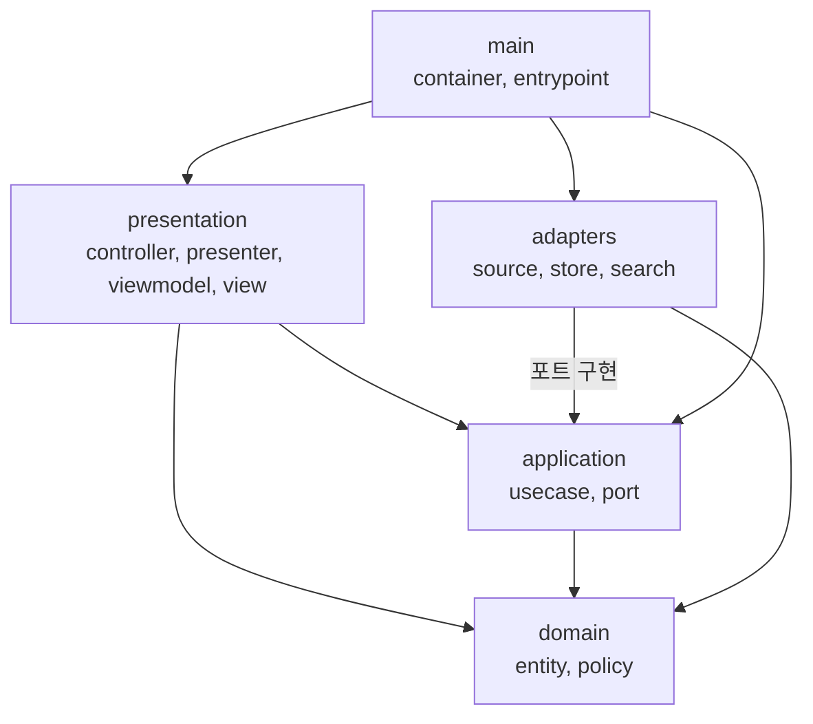

# CS한잔 사이트 소프트웨어 구조

| 항목 | 내용 |
|---|---|
| 문서 상태 | 초안 v0 |
| 작성일 | 2026-10-15 |
| 대상 | CS한잔 사이트의 코드 구조. 질문 생성 파이프라인은 [../pipeline/pipeline-overview.md](../pipeline/pipeline-overview.md) 참조 |
| 관련 문서 | [site-spec.md](./site-spec.md), [site-design.md](./site-design.md), [ADR-0001](../adr/0001-rendering-strategy.md), [ADR-0002](../adr/0002-auto-close-marker.md), [ADR-0003](../adr/0003-tech-stack.md) |

## 1. 목적

사이트 코드를 레이어로 나누고 레이어 간 의존 방향을 고정합니다. 외부 시스템(GitHub, 검색)과 프레임워크(Next.js 캐시와 라우팅)는 교체 가능한 부품으로 분리합니다. 배포 환경(Vercel)이나 캐시 API가 바뀌어도 수정이 `main`과 배포 설정에 머물게 하는 것이 구조 설계의 핵심 근거입니다([ADR-0001](../adr/0001-rendering-strategy.md), [ADR-0003](../adr/0003-tech-stack.md)).

## 2. 설계 원칙

| 원칙 | 내용 |
|---|---|
| 의존성 역전(DIP) | 상위 정책(유스케이스)이 인터페이스(포트)를 소유하고, 하위 세부 사항(어댑터)이 이를 구현 |
| 레고식 조립 | 구현체 선택은 `main/container`에서만 수행. 부품 교체가 다른 레이어의 수정으로 번지지 않음 |
| 프레임워크는 세부 사항 | 웹 프레임워크와 빌드 도구는 최외곽에 배치 |
| 읽기 전용 단순성 | 쓰기 경로가 없으므로 ViewModel은 불변 데이터로 한정 |
| 대체 구현 필수 | 모든 포트에 테스트용 대체 구현(fixture, 메모리)을 둠 |
| 수직 슬라이스 | 레이어별로 먼저 만들지 않고 슬라이스(S0~S4)에 필요한 요소만 관통해서 구현 |

### 결정 상태

| 항목 | 상태 |
|---|---|
| 클린 아키텍처 계열 레이어, DIP, 레고식 조립 | 확정 (요구사항 제공자 요청) |
| MVC와 MVVM 개념 반영 | 확정 (요구사항 제공자 요청) |
| 레이어 이름과 분할 수준 | AI 제안(확인 필요) |
| 포트 4종(ADR-0003에 맞춰 저장소 포트를 웹훅 검증, 캐시 무효화 포트로 교체) | AI 제안(확인 필요) |
| Controller → Presenter → ViewModel → View 매핑 | AI 제안(확인 필요) |
| 사이트 소스를 `site/` 폴더에 배치 | 확정(AI 제안 수락, [ADR-0003](../adr/0003-tech-stack.md)) |

## 3. 패턴 대응

| 패턴 | 이 프로젝트의 대응 | 적용 범위 |
|---|---|---|
| 클린 아키텍처 | domain, application, adapters, presentation 레이어와 조립부 main. 의존은 안쪽으로만 향함 | 전체 골격 |
| MVC | Controller는 요청을 받아 유스케이스 호출. View는 화면 템플릿. Model은 domain과 application | presentation |
| MVVM | ViewModel은 화면 표시용 불변 데이터. 데이터 바인딩과 양방향 동기화는 사용하지 않음 | presentation |

세 패턴은 하나의 흐름으로 연결됩니다.

```
Controller → UseCase → Presenter → ViewModel → View
```

Presenter가 도메인 결과를 ViewModel로 변환하고, View는 ViewModel만 읽습니다.

MVVM의 바인딩은 입력과 상태 변경이 있는 화면에서 이점이 큽니다. 이 사이트는 읽기 전용이고 입력이 검색에 한정되므로 바인딩을 도입하지 않습니다. 검색 화면에 클라이언트 상호작용이 생기면 재검토합니다.

## 4. 레이어와 의존 방향



화살표는 "알고 있음(import)"을 나타냅니다. domain은 아무것도 가리키지 않습니다.

## 5. 레이어별 책임

| 레이어 | 책임 | 구성 요소 | 의존 허용 | 의존 금지 |
|---|---|---|---|---|
| domain | 업무 규칙과 데이터 의미 | entities, policies | 없음 | 외부 라이브러리, 입출력, 다른 레이어 |
| application | 사용 사례의 흐름, 외부 접점 정의 | usecases, ports | domain | adapters, presentation, 프레임워크, 입출력 |
| adapters | 포트 구현(외부 시스템 연결) | source, store, search | application(ports), domain | presentation, 다른 어댑터 |
| presentation | 요청 처리와 화면 구성 | controllers, presenters, viewmodels, views, styles | application(usecases), domain | adapters |
| main | 구현체 선택, 조립, 진입점 | container, entrypoints | 전체 | 업무 규칙 |

View는 ViewModel만 입력으로 받습니다. domain 객체를 View로 직접 전달하지 않습니다.

## 6. 도메인 모델

필드명은 S0에서 GraphQL 실제 응답으로 확인합니다.

| 요소 | 내용 |
|---|---|
| Question | number, title, category, createdAt, closed, url |
| Answer | id, questionNumber, author(null 허용), bodyHtml(살균 완료), bodyText(검색용), createdAt, parentId |
| Author | login |
| Category | 제목의 `[카테고리]` 접두어에서 추출한 값 |
| AutoClosePolicy | 마감 댓글 판정 ([ADR-0002](../adr/0002-auto-close-marker.md)) |
| CategoryExtractor | 제목에서 카테고리 추출 |

## 7. 포트

| 포트 | 소유 레이어 | 메서드(개념) | 실제 구현 | 대체 구현 |
|---|---|---|---|---|
| DiscussionSource | application | fetchAll, fetchOne(number) | GitHub GraphQL 어댑터 | fixture 파일 어댑터 |
| SearchIndex | application | build(questions), query(text) | 부분 문자열 일치 | 같은 구현(입출력 없음) |
| WebhookReceiver | application | receive(body, signature, eventName) | GitHub 웹훅 어댑터. HMAC-SHA256 서명 검증과 이벤트 해석(질문 번호 추출) | 결과를 고정해 돌려주는 구현 |
| CacheInvalidator | application | invalidateQuestion(number), invalidateLists() | Next.js 캐시 태그 재검증(`main`) | 호출 기록 구현 |

- 저장소 포트(ArchiveWriter, ArchiveReader)는 두지 않습니다. Vercel은 파일 저장소가 유지되지 않으므로 데이터 캐시가 저장소 역할을 합니다([ADR-0003](../adr/0003-tech-stack.md)).
- 캐시는 `main/container`에서 DiscussionSource를 감싸 적용합니다. `fetchOne`에는 `q-{number}` 태그, `fetchAll`에는 목록 태그를 붙입니다. 다른 레이어는 캐시 존재를 모릅니다.
- CacheInvalidator의 실제 구현은 Next.js API를 쓰므로 `main`에 둡니다.
- DiscussionSource 어댑터는 GraphQL 응답을 도메인이 이해하는 형태로 변환하는 경계입니다. GraphQL 필드명은 이 어댑터 안에서만 사용하고, `bodyHTML` 살균도 여기서 수행합니다.

## 8. 유스케이스

| 유스케이스 | SPEC 연결 | 사용 포트 |
|---|---|---|
| ListCategories | FR-1 | DiscussionSource |
| ListQuestionsByCategory | FR-1, SC-3 | DiscussionSource |
| ListRecentQuestions | 홈 | DiscussionSource |
| GetQuestionDetail | FR-1, SC-2 | DiscussionSource |
| ListAnswersByAuthor | FR-2, SC-1 | DiscussionSource |
| SearchQuestions | FR-3 | DiscussionSource, SearchIndex |
| HandleDiscussionEvent | FR-4 | WebhookReceiver, CacheInvalidator |
| WarmQuestionCache | FR-4 | DiscussionSource, CacheInvalidator |

- 마감 댓글 제외(C-1)와 카테고리 추출은 각 유스케이스가 도메인 정책(AutoClosePolicy, CategoryExtractor)으로 수행합니다.
- 열린 화면의 15초 폴링 API는 GetQuestionDetail 결과를 그대로 돌려주고, 새 답변 판별은 화면(클라이언트)에서 id 비교로 합니다. 질문당 답변이 수 건이라 별도 유스케이스를 두지 않았습니다(S2).
- 웹훅 포트는 처음 설계의 WebhookVerifier(서명 검증만)에서 WebhookReceiver(검증과 해석)로 넓혔습니다. 해석까지 어댑터에 두어 GitHub 웹훅 필드명이 유스케이스로 새지 않게 했습니다(S2).
- 답변 수는 최상위 댓글만 셉니다. 답글은 답변 카드 안에 표시하고 따로 셉니다(S2).

## 9. 폴더 구조

```
.
├─ .claude/
│  ├─ rules/
│  │  └─ site-layer-rules.md    # 레이어 의존 규칙 (paths: site/src/**)
│  ├─ skills/                   # 반복 절차 (구현 단계에서 추가)
│  ├─ agents/                   # 출력이 긴 검증 작업 위임 (구현 단계에서 추가)
│  ├─ hooks/                    # 훅 스크립트 (구현 단계에서 추가)
│  └─ settings.json             # 훅 등록
├─ .github/
│  ├─ pull_request_template.md
│  └─ workflows/                # 테스트와 점검 (구현 단계에서 추가)
├─ CLAUDE.md
├─ README.md
├─ docs/
│  ├─ pipeline/
│  │  └─ pipeline-overview.md   # 질문 생성 파이프라인 설명 (n8n)
│  ├─ site/
│  │  ├─ site-spec.md
│  │  ├─ site-structure.md      # 이 문서
│  │  └─ site-design.md
│  ├─ adr/
│  │  ├─ 0001-rendering-strategy.md
│  │  ├─ 0002-auto-close-marker.md
│  │  └─ 0003-tech-stack.md
│  └─ ai/
│     ├─ ai-workflow.md
│     ├─ ai-log-guide.md
│     └─ logs/                  # 작업별 기록 (YYYY-MM-DD-제목.md)
├─ n8n/
│  └─ daily-question-workflow.json
└─ site/                        # 사이트 소스 (구현 단계에서 생성)
   ├─ src/
   │  ├─ app/                   # Next.js 라우트. Controller만 호출하는 얇은 연결 코드
   │  │  ├─ (pages)/            # 홈, 카테고리, 질문 상세, 작성자, 검색
   │  │  └─ api/
   │  │     ├─ webhooks/github/ # 웹훅 수신
   │  │     └─ questions/[number]/answers/  # 폴링 API
   │  ├─ domain/
   │  │  ├─ entities/           # Question, Answer, Author, Category
   │  │  └─ policies/           # AutoClosePolicy, CategoryExtractor
   │  ├─ application/
   │  │  ├─ usecases/
   │  │  └─ ports/              # DiscussionSource, SearchIndex, WebhookReceiver, CacheInvalidator
   │  ├─ adapters/
   │  │  ├─ source/             # github-graphql, fixture
   │  │  ├─ search/             # substring
   │  │  └─ webhook/            # github-webhook-receiver
   │  ├─ presentation/
   │  │  ├─ controllers/
   │  │  ├─ presenters/
   │  │  ├─ viewmodels/
   │  │  ├─ views/              # 서버 컴포넌트, 클라이언트 컴포넌트(테마, 검색 입력, 답변 폴링)
   │  │  └─ styles/
   │  └─ main/
   │     ├─ container/          # 구현체 선택과 조립, 캐시 적용
   │     └─ cache/              # Next.js 캐시 API 사용 지점(CacheInvalidator 구현)
   └─ tests/
      ├─ fixtures/              # 엣지 케이스 샘플
      ├─ domain/
      ├─ application/
      ├─ adapters/
      └─ presentation/
```

패키지 설정 파일은 S0에서 `site/` 아래에 추가합니다. `site/src/app`은 Next.js가 강제하는 라우팅 폴더이므로 Controller만 호출하는 얇은 연결 코드로 한정합니다([ADR-0003](../adr/0003-tech-stack.md)).

문서 파일명은 저장소 안에서 유일하며 `{영역}-{주제}.md` 형식을 따릅니다. 규칙은 `CLAUDE.md`의 "문서 규칙"에 있습니다.

## 10. 처리 흐름

### 10.1 갱신(웹훅)

| 단계 | 동작 | 담당 |
|---|---|---|
| 1 | `discussion_comment`, `discussion` 웹훅 수신 | app/api/webhooks/github → presentation/controllers |
| 2 | HandleDiscussionEvent 호출 | application/usecases |
| 3 | 서명 검증(실패 시 401)과 질문 번호 추출 | WebhookReceiver |
| 4 | 해당 질문 태그와 목록 태그 재검증 | CacheInvalidator |
| 5 | 응답 후(`after`) 그 질문과 전체 목록을 미리 조회해 캐시를 채움. 웹훅이 알려 준 변경(댓글 ID, 수정 본문, 글 존재 여부)이 조회 결과에 아직 없으면 비우고 재시도 | WarmQuestionCache |
| 6 | 이후 방문은 캐시를 받음 | main/container의 캐시 |

웹훅 누락 대비로 시간 기반 재검증을 함께 둡니다([ADR-0001](../adr/0001-rendering-strategy.md) 5장).

### 10.2 조회

| 단계 | 동작 | 담당 |
|---|---|---|
| 1 | 요청 수신 | app 라우트 → presentation/controllers |
| 2 | 유스케이스 호출 | application/usecases |
| 3 | 캐시된 Discussions 조회 | DiscussionSource(캐시 적용) |
| 4 | 마감 댓글 제외, 카테고리 추출 | domain/policies |
| 5 | ViewModel 생성 | presentation/presenters |
| 6 | 화면 렌더링 | presentation/views |

### 10.3 폴링(열린 질문 상세)

| 단계 | 동작 | 담당 |
|---|---|---|
| 1 | 15초마다 마지막 답변 id로 요청 | presentation/views의 클라이언트 컴포넌트 |
| 2 | GetQuestionDetail 호출 | app/api/questions → controllers → usecases |
| 3 | 새 답변 ViewModel 반환 | presentation/presenters |
| 4 | 추가는 끝에 붙이고, 수정은 본문을 바꾸고, 삭제는 제거해 그 영역만 다시 그림 | 클라이언트 컴포넌트(presenters/merge-threads) |

## 11. 배포 환경과의 관계

[ADR-0001](../adr/0001-rendering-strategy.md)에 따라 Vercel에 배포합니다. 배포 환경을 바꿀 때 영향 범위는 아래와 같습니다.

| 변경 | 바뀌는 곳 | 바뀌지 않는 곳 |
|---|---|---|
| Vercel에서 EC2 등 Node 환경으로 이전 | 배포 설정, 필요 시 `main/cache` | domain, application, adapters, presentation |
| Next.js 캐시 API 변경 | `main/cache`, `main/container` | 나머지 전체 |

## 12. 테스트와 검증

### 12.1 레이어별 방식

| 대상 | 방식 | 첫 적용 |
|---|---|---|
| domain | 입출력 단위 테스트(마감 댓글 판정, 카테고리 추출) | S0 |
| application | 대체 구현을 주입한 유스케이스 테스트. 건수 일치 확인(FR-1, FR-2) | S1 |
| adapters | 계약 테스트. 같은 테스트를 대체 구현과 실제 구현에 모두 적용 | S0 |
| presentation | 샘플 데이터로 화면 확인(작성자 null, 빈 본문, 긴 코드블록, 이모지) | S2 |
| 의존 규칙 | 레이어 간 import 방향 자동 검사(dependency-cruiser) | S0 이전 |

### 12.2 슬라이스와 레이어

| 슬라이스 | 관통하는 요소 |
|---|---|
| S0 | 엔티티, 정책, DiscussionSource 포트, github-graphql과 fixture 어댑터, 본문 살균 |
| S1 | ListCategories, ListQuestionsByCategory, ListRecentQuestions, 홈과 카테고리 화면, 공통 레이아웃, `main/container` 조립과 데이터 캐시 적용 |
| S2 | GetQuestionDetail, HandleDiscussionEvent, WarmQuestionCache, 웹훅과 폴링 API, 질문 상세 화면 |
| S3 | ListAnswersByAuthor, 작성자 화면 |
| S4 | SearchQuestions, 검색 어댑터, 검색 화면 |

## 13. 보안과 권한

| 항목 | 규칙 |
|---|---|
| 토큰 권한 | 읽기 전용, 최소 범위 |
| 토큰 보관 | GraphQL 토큰과 웹훅 비밀값은 Vercel 환경 변수. 저장소 커밋 금지. 클라이언트 컴포넌트로 전달 금지 |
| 웹훅 | `X-Hub-Signature-256` 서명 검증 실패 시 401. 검증 전에는 본문을 처리하지 않음 |
| 본문 렌더링 | GitHub `bodyHTML`도 외부 입력이므로 DiscussionSource 어댑터 경계에서 다시 살균(sanitize) 필수 |
| 공개 범위 | 저장소 public. 참여 팀원 동의 완료(C-2) |
| 신규 참여자 | 공개 동의 수집 방식 미결정. 결정 전에는 신규 참여자의 답변도 자동 노출되는 위험이 있음 |

## 14. 미결정 사항

| 항목 | 비고 |
|---|---|
| 식별자 표기 | 영문 식별자 사용 가정. 확정 필요 |
